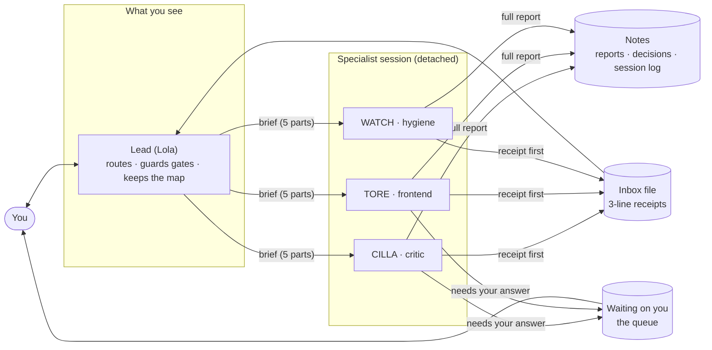
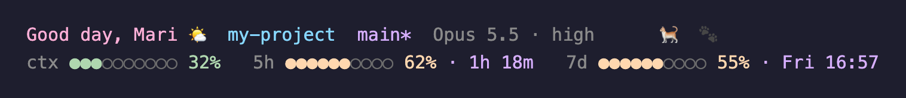

# Mari's AI Setup

**My Claude Code setup, made portable.** The lead/specialist method (Lola) as a plugin, a
role catalogue, ten generic skills, a handful of scripts, a status line, and an installer
that links it all into `~/.claude` on any machine.

Hi, I'm Mari Svennevik Notland ([@Mariisno](https://github.com/Mariisno)), a UX designer.
I usually have several Claude Code sessions going at once, and without some order it got
messy fast: who is doing what, which answer is waiting on me, where did that decision end
up. So I settled on a way of working where I talk to one session, the lead, and it hands
the work to named specialists and keeps track of them. This repository is that setup,
with everything personal moved into one config file, so it runs the same on any machine.
Take what's useful to you.

> **Kort på norsk:** dette er Claude Code-oppsettet mitt, gjort generisk så jeg kan ha det
> på flere maskiner, og så andre kan bruke det. Én konfigfil (`~/.lola/config.sh`) holder
> alt som er personlig: navn, språk, ledere, kontoer og hvor notatene bor. Resten er likt
> overalt. Installer med `./install.sh`, og les videre på engelsk for detaljene.



You talk to one session, the **lead**. It doesn't do the heavy lifting: it starts named
**specialists** from a **role catalogue** in a hidden tmux session, gives each a complete
brief, and keeps track of who is doing what. Specialists report through plain inbox files.
Anything that needs *your* answer lands in one queue. Every decision ends up in your notes.
You spend your time on judgment, decisions and taste.

## What's in it

| Folder | What | Where it goes |
|---|---|---|
| `plugins/lola/` | the method as a Claude Code plugin: `lead`, `specialist`, `watch`, `harvest`, `setup` skills · `lola-spawn`, `lola-send`, `lola-revive`, `lola-init`, `lola-watch-report` · the identity hook and the dig-guard hook · the **role catalogue** (`roles/`) · tests | installed as a plugin from this repository (it is its own marketplace) |
| `skills/` | ten generic skills: `task-brief` · `sidequest` · `method-issue` · `testing` · `test-round` · `tired-mode` · `microcopy` · `notes-lookup` · `session-summary` · `user-stories` | symlinked into `~/.claude/skills/` |
| `scripts/` | `quota.sh` (room left) · `maintenance.sh` (updates and upkeep) · `memory-crossref.sh` (memories across folders) · `skill-audit.sh` (dead `[[links]]`) · `skill-usage.sh` (what is actually used) | symlinked into `~/.claude/scripts/` |
| `statusline/statusline.sh` | greeting · project · branch · model + effort · meters for context, 5-hour and weekly limits · Sussi the cat (`STATUSLINE_PERSONAL=0` leaves her out) | symlinked to `~/.claude/statusline.sh` |
| `CLAUDE.md.template` | the structure of a global instructions file: about me · how to talk to me · ask first · rules for every session · notes · skills · scripts · git | rendered to `~/.claude/CLAUDE.md` if you have none |
| `install.sh` | does the linking, with `--dry-run` and a backup of anything it replaces | — |



The status line's cat is Sussi, the cat my design system is named after. She is my
signature; `STATUSLINE_PERSONAL=0` (in the environment or in `config.sh`) leaves her out.
`statusline.sh --help` lists the options. The screenshot uses demo data.

Everything reads **one config file**, `~/.lola/config.sh`. No path is hard-coded; `$HOME`
and the config decide.

## Get started in five minutes

**Requirements:** macOS or Linux · [tmux](https://github.com/tmux/tmux) · [jq](https://jqlang.org) ·
Python 3 · Claude Code 2.1.284 or later.

1. **Clone and look before you leap:**

   ```sh
   git clone https://github.com/Mariisno/maris-ai-setup ~/maris-ai-setup
   cd ~/maris-ai-setup
   ./install.sh --dry-run
   ```

2. **Install.** Links skills, scripts and the status line into `~/.claude` (or
   `$CLAUDE_CONFIG_DIR`), creates `~/.lola/config.sh`, and renders `CLAUDE.md` if you have
   none. Anything it would replace is moved to a backup folder first.

   ```sh
   ./install.sh
   ```

3. **Install the plugin** (the script prints these; they write to your plugin settings, so
   you run them yourself):

   ```sh
   claude plugin marketplace add ~/maris-ai-setup
   claude plugin install lola@maris-ai-setup
   ```

4. **Tell it who you are.** Open `~/.lola/config.sh` and set your name, your language,
   and your leads. Then fill the «…» parts
   of `~/.claude/CLAUDE.md`. Add the `statusLine` snippet from `settings.example.json` to
   `~/.claude/settings.json` by hand.

5. **Start.** In any Claude Code session: `/lola:setup init`, then `/lola:setup revive`,
   then `tmux attach -t lola` in your terminal. Ask the lead for something real. It starts a
   specialist with `lola-spawn --role …`, and a three-line receipt appears in
   `~/.lola/inbox/LOLA.md` when the work is done.

A second machine is steps 1–3 again; the config file and your notes are the only things to
carry over.

## One config file

[`plugins/lola/templates/config.example.sh`](plugins/lola/templates/config.example.sh)
documents every key. The ones you will touch:

| Key | What it is |
|---|---|
| `LOLA_USER_NAME` · `LOLA_LANGUAGE` | how sessions address you; the language they write notes and reports in |
| `LOLA_LEADS` | one lead per domain: `NAME\|domain\|tmux session\|working dir` |
| `LOLA_NOTES_DIR` · `LOLA_NOTES_STYLE` | any folder of Markdown, or an Obsidian vault (`obsidian` writes `[[wikilinks]]`) |
| `LOLA_ROLES_DIR` | the role catalogue; point it at a copy to edit roles and add your own domains |
| `LOLA_SPECIALIST_CAP` | how many specialists one lead may run at once (default 5) |

## The role catalogue

A specialist is named by **what it can do** (the role) and **where it works** (the domain).
Roles are generic and ship with the plugin: `ux/service-design`, `ux/ui`, `ux/microcopy`,
`ux/critic`, `dev/frontend`, `dev/backend`, `dev/mobile`, `product/tracker`, `test/tester`,
`ops/watch`, `ops/harvest`. Domains are yours: copy `roles/domains/work.md` once per real
domain and write in the lead, the inbox, the repositories, the board, and who owns what.
That is where the real names live; the roles never mention them.

```sh
lola-spawn --role ux/critic --domain work --name CILLA "Review the checkout flow against …"
# → pane label "CILLA · CRITIC · Work (LOLA)", Opus 5.5 · high from the role file,
#   brief prefaced with "Read roles/ux/critic.md and roles/domains/work.md first."
```

[`plugins/lola/roles/README.md`](plugins/lola/roles/README.md) has the table of which role
answers which question.

## The rules, briefly

The `lead` skill has them in full.

1. **One lead per domain, specialists for the work.** Specialists get names and fixed roles.
2. **Every brief has five parts:** the task · boundaries · sources · delivery · how to report.
3. **Receipt first.** Three lines to the lead's inbox as soon as the result is usable.
4. **The queue holds only what waits on your answer.** Not your task list.
5. **Gates:** nothing is deleted and nothing leaves the machine without your explicit yes.
6. **Rule four: the lead doesn't dig.** A hook reminds it; it warns, never blocks.
7. **Rule five: every insight goes to the notes,** linked, with its source. HARVEST catches
   what the leads missed.

## The skills

| When | Skill |
|---|---|
| Formulate a task well, or find out why an answer was poor; the paste-ready prompt rule (model + effort, always) | `task-brief` |
| Something new turns up mid-task | `sidequest` |
| Our own method slipped | `method-issue` |
| Which test layer, and is it tested enough · what exactly do I click | `testing` · `test-round` |
| Words in the interface · requirements into stories | `microcopy` · `user-stories` |
| What have we already noted · save the session | `notes-lookup` · `session-summary` |
| I'm tired | `tired-mode` |

They are written in English and tell the session to *write* in `LOLA_LANGUAGE`; their
trigger lines carry Norwegian phrases too, so they fire in either.

## Safety

- Nothing here uploads anything. Two scripts read from the network: `maintenance.sh` asks
  the npm registry for the newest Claude Code version, and `lola-watch-report` reads GitHub
  only if you set `LOLA_GITHUB_USER`.
- `install.sh` creates symlinks, the config and (optionally) `CLAUDE.md`. It never edits
  `settings.json`, never overwrites without a backup, and `--dry-run` shows every step.
- No telemetry. Nothing reports usage, installs or errors anywhere.
- The plugin's scripts mark every tmux session they create and touch nothing without the
  mark. Details in [`plugins/lola/README.md`](plugins/lola/README.md).

## Tests

```sh
plugins/lola/test/run.sh
```

Bash and awk only, no tmux needed: scripts parse, menu detection, label option, the role
catalogue's machine lines, and `lola-spawn --role` resolution (dry run).

## License

MIT. See [LICENSE](LICENSE). Made by Mari Svennevik Notland
([@Mariisno](https://github.com/Mariisno)).

The installer prints where the setup comes from, every installed script starts with a
one-line credit, and each skill names its author in its frontmatter. If you copy or build
on any of it, keep that line and the copyright notice, as the license asks.
